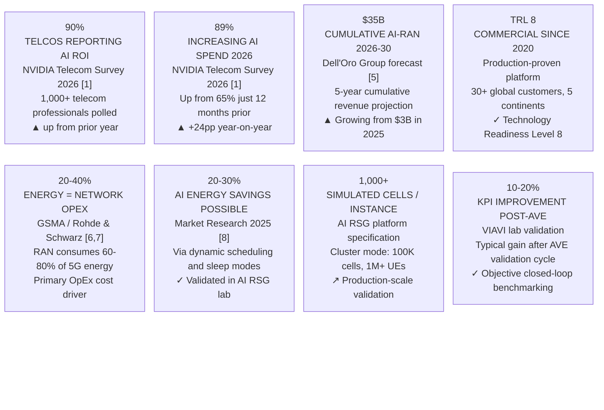
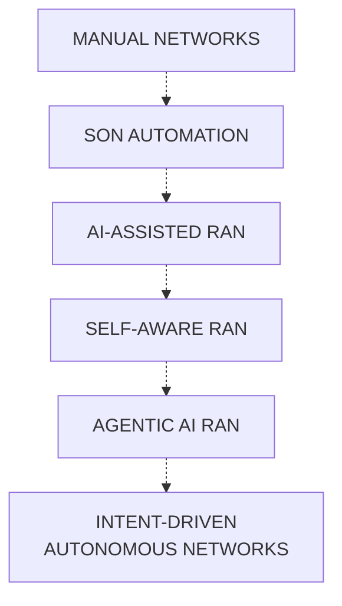
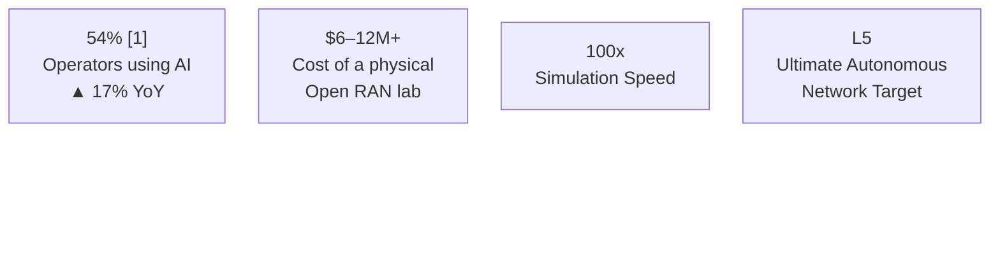
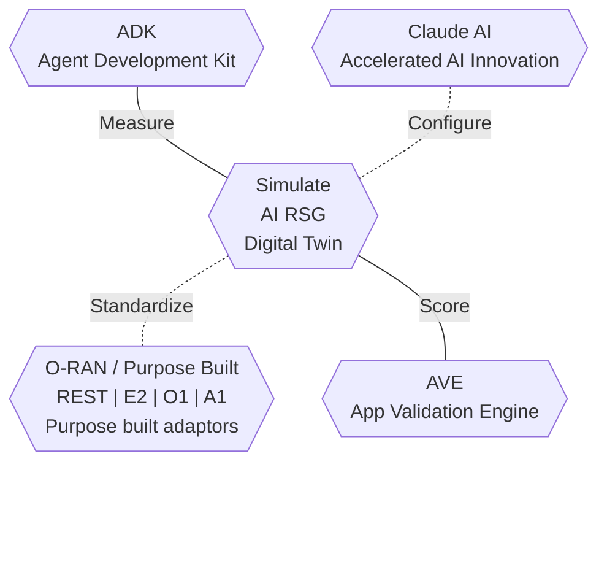
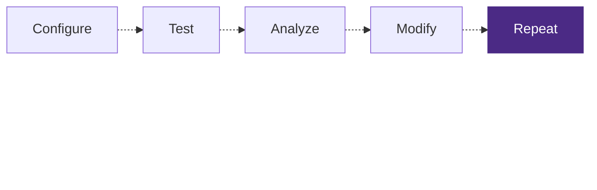
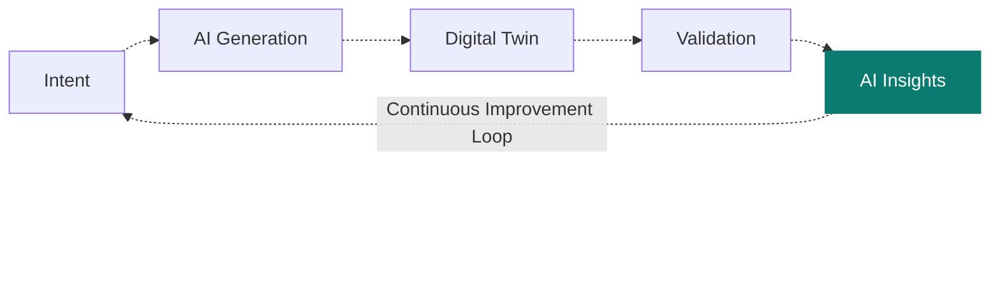
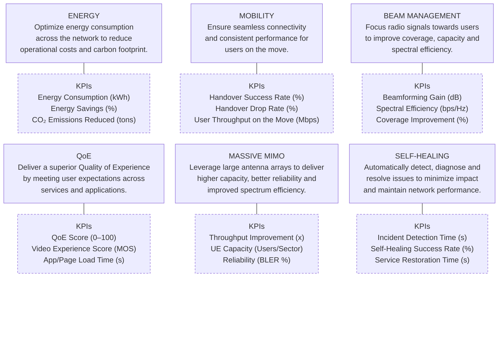
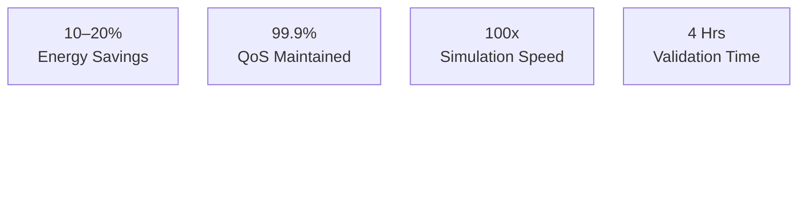
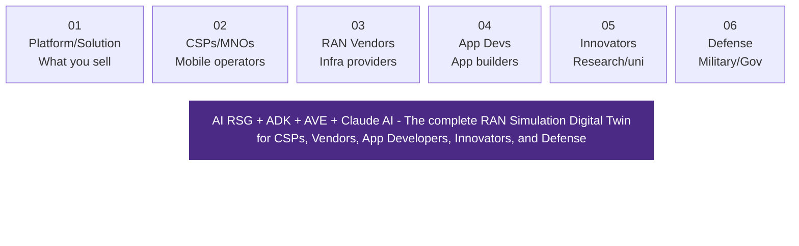
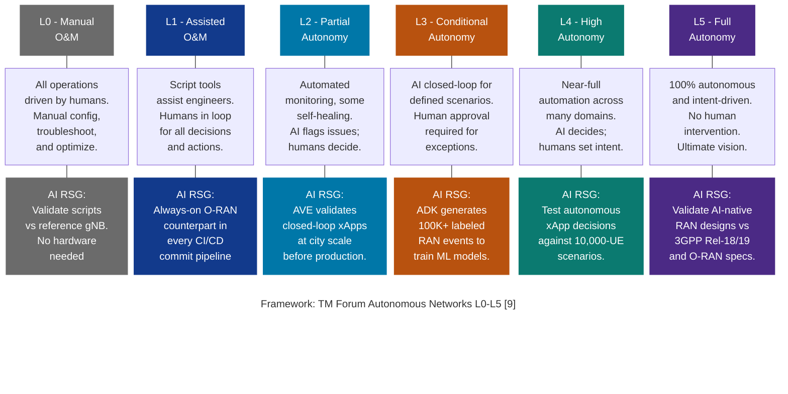

# Building confidence in AI Model
Ensuring AI models are trained on dataset that accurately reflects real RAN and/or Core network conditions.
How the generated datasets are realistic and trustworthy for ingestion to AI Models or LLMs so that they can behave in real time as we expect for outcome?

Live networks don't always provide enough examples of unusual events, such as interference, 
unexpected traffic patterns, handover failures or network outages, 
making it difficult to properly train and test AI models.

AI Models life cycle management in an operational network.

Any possible outage scenario if __increase AI workload__ creates overload on traditional network hardware like L2 switches or routers which are configured with hardware peak data rate limit. 
Exceeding Fronthaul capacity or rate boundary. 

## Simulation perspective
How to combine synthetic scenarios with real network data, allowing teams/designers to generate __realistic training datasets__
and safely reproduce varrying network conditions.
* I will do all simulation in Claude app.

## Rigorous AI Validation Techniques

```

  [Large Telco Models] ➔ [Intent-Driven Guardrails] ➔ [Digital Twin Simulation] ➔ [Human-in-the-Loop Approval]

```

## Challenges for L1/L2 stack 

Unlike higher-level orchestration (which operates in seconds or minutes), 
the L1/L2 AI Models run directly on the data plane and hardware accelerators (HWAs). Some challenges are below..

* **Microsecond Deadline (Hard Real-Time)**: At Layer 1, functions like channel estimation, Massive MIMO beamforming, and interference cancellation must execute within a fraction of a slot duration (often < 500 μs). If an AI model introduces a L1 processing bottleneck, it causes packet drops and immediate SLA violations.
  
* **Extreme Resource Constraints**: Deep learning models are inherently compute-heavy. Running __unoptimized neural networks__ on edge cell sites strains local hardware accelerators (FPGAs, eASICs, GPUs, SoCs), skyrocketing the network's Power Consumption (OPEX), spikes in power budget.
  
* **"Black Box" Channel Paradox**: Radio frequency (RF) channels fluctuate unpredictably due to sudden blockages, weather, or high mobility (e.g., bullet trains). An AI model trained on historical channel state information (CSI) can easily fail when encountering a novel, real-world multi-path signal fading environment.

## Pre-deployment validation playbook for AI in the RAN

Confidence is evidence that a specific model version behaves acceptably for a defined use case, on a defined network, under normal and degraded conditions. A high model score is not a release decision. Before a model controls live traffic, establish independently that it makes useful decisions, protects service, and has a credible business case. Record untested conditions and keep the baseline policy in control there.

### 1. Define the operating envelope and pass criteria

- Document the decision, inputs, outputs, timing deadline, allowed actions, control authority, dependencies, and fallback. Separate **observe** (read-only), **recommend** (human approval), and **act** (automated control); require stronger evidence as authority and potential impact increase.
- State the supported bands, bandwidths, duplex modes, radio configurations, cell types, UE capabilities, vendors, software versions, traffic and mobility ranges, and service classes. Define how unsupported, stale, or unknown conditions are detected and handled.
- Compare against the current operator policy with identical guardrails and inputs where possible, and against a simple heuristic or statistical model. Set a minimum worthwhile improvement, non-inferiority margins for protected service KPIs, hard safety limits, test duration, sample size, and stop rules before tuning.
- Map every critical requirement to a scenario, metric, threshold, evidence artifact, and owner. Treat absent evidence in a critical scenario as a coverage gap, not a pass.

| Placement or use case | Examples of behavior to validate |
| --- | --- |
| PHY: Adaptive waveform, beam, CSI, or link adaptation | BLER, beam failures and recovery, spectral efficiency, and deadline misses under changing channel conditions; retain a conventional control path. |
| MAC: Scheduling or resource allocation | Cell-edge and per-service throughput, HARQ behavior, queue delay, fairness, and deadline misses under bursty loads and mixed QoS. |
| RLC / PDCP, where applicable | Buffer and discard behavior, retransmissions, packet loss and ordering, and tail latency across transport and mobility conditions. |
| RRC / mobility | Handover success, interruption time(HOIT), radio link failures(or link readaptation), and ping-pong rates across speeds, cell boundaries, and neighbor combinations. |
| RIC / SON: optimization or energy saving | Neighbor-cell impact, oscillation and convergence, coverage, wake-up delay, and energy per delivered unit of traffic alongside absolute energy use. |

### 2. Establish that the data and simulator represent the network

- Inventory and version the telemetry, labels, feature definitions, configurations, and collection windows. Verify units, time alignment, counter resets and denominators, missingness, sampling bias, and label quality. Check that each feature would be available by the real decision deadline and that training and serving compute it the same way.
- Split data before fitting, simulation calibration decisions, or augmentation. Use time-forward holdouts and hold out entire sites or correlated cell clusters, devices, incidents, or vendor configurations as applicable. Keep the final test set locked. Deduplicate before splitting and prevent leakage from future KPIs, overlapping windows, or synthetic variants of test traces.
- Use approved, minimized telemetry; pseudonymize sensitive identifiers, restrict access and retention, and avoid subscriber payloads unless specifically authorized and necessary. Document collection gaps and what cannot be inferred.
- Calibrate a system/link simulator or digital twin against approved real traces. Compare joint distributions, time dynamics, handover and interference patterns, and KPI tails on separate real traces, not just averages on calibration sites. Record where fidelity is insufficient; report results on real-only, synthetic-only, and blended sets separately. Do not treat synthetic samples as independent evidence of real-world uplift.
- Build a coverage matrix spanning busy and quiet hours, urban/rural and indoor/outdoor sites, cell edge, UE mixes, mobility, traffic profiles, and seasonal or special-event peaks. Add rare and combined cases in the lab: congestion with handovers, neighbor outages with load shifts, interference or coverage degradation, telemetry delay/loss, and equipment or software changes. Use systematic scenario sweeps, boundary tests, and multiple random seeds; separate plausible scenarios from out-of-envelope stress tests.

### 3. Validate offline performance, uncertainty, and control behavior

- Match metrics to the decision: precision/recall at the action threshold for alerts, forecast error and interval coverage for predictions, and service KPIs plus constraint violations for control. Compare at the same operating point or action budget. Report denominators, tail percentiles, and results by site, band, device, service class, mobility, and load, including the worst supported slices.
- Quantify uncertainty in two different ways. For predictive confidence, use reliability plots and Brier score for probabilities or empirical coverage for prediction intervals; check calibration by slice and under shift. For KPI uplift, report confidence intervals that account for correlated cells and time windows (for example, cluster or block bootstrap). Define a minimum sample size per critical slice; do not treat zero observed failures as proof of zero risk.
- Evaluate abstention on missing, stale, noisy, and out-of-distribution inputs. Plot error versus coverage, measure missed detections and false alarms for drift checks where labeled shifts exist, and verify that fallback preserves service KPIs. Calibrate thresholds on validation data, not the locked test set. Check that model decisions change sensibly when relevant inputs change and remain stable under benign measurement noise.
- Replay representative and incident traces with recorded event order and timing, using the release model and the baseline side by side. Replay verifies observation and decision behavior, not how the network would respond to a different action. For policies evaluated from logged actions, use off-policy estimates only where action coverage and logging assumptions hold; mark unsupported actions as unevaluable.
- In closed-loop simulation, let actions change future traffic, radio state, and neighbor load. Check feedback stability, recovery time, action limits, and interactions with existing SON/RIC controllers; include conflicting policies, repeat decisions, and delayed measurements. Where feasible, verify hard invariants on the action guardrails and complement average-case tests with worst-case scenario search.
- If an LLM is used for operator recommendations, test factual grounding against approved runbooks and telemetry, stale or conflicting evidence, abstention, structured output validation, and human approval. Keep free-form output out of direct RAN control paths.

### 4. Prove integration and recovery on the target stack

- Progress from software-in-the-loop to hardware-in-the-loop and a production-like staging RAN. Use UE and traffic emulators, channel emulators or authorized shielded RF testing, and representative RU/DU/CU, edge hardware, and controller versions. Verify applicable 3GPP and O-RAN interface behavior for the deployed releases, including contracts, timing, partial upgrades, and multi-vendor interoperability.
- Run end-to-end peak, burst, and soak tests on the packaged model, including quantized or accelerated builds. Measure full telemetry-to-action latency and jitter (including tail latency and deadline-miss rate), synchronization, CPU/GPU/memory, power, and any impact on other workloads. Check cold start, restart, and upgrade behavior, not just average inference speed.
- In an isolated testbed, exercise missing or reordered telemetry, clock drift, failed dependencies, overloaded inference, and disconnected controllers. Verify input/schema validation, model provenance and integrity, least-privilege access, and auditable model decisions without logging sensitive payloads.
- Keep operator-owned action bounds, rate limits, expiry, and conflict arbitration outside the model. Rehearse manual override, automatic fallback, and rollback to the known-good policy, including removal of persistent actions and reconciliation of controller state. Measure time to detect, stop, and restore service; verify the fallback still works when the model or monitoring is unavailable.

### 5. Separate pre-traffic evidence from production exposure

| Stage | What it proves and what it does not |
| --- | --- |
| Offline, simulation, and isolated staging | No production exposure. Validate envelope coverage, stability, integration, and recovery. Passing permits an operator review; it does not authorize control of live traffic. |
| Read-only shadowing, only after operator approval | Evaluate on mirrored live telemetry with no actuation permissions and isolated or bounded resources. Check live feature parity, freshness, latency, guardrail rejects, abstentions, and disagreements with the baseline. Shadowing cannot measure the causal effect of actions never applied, and is not required if live data access is disallowed. |
| Limited live canary, only after pre-deployment sign-off | This is **production deployment**, not a pre-traffic test. Limit to approved sites, actions, and exposure windows; exclude protected services or sites as required. Use independent abort monitoring, an on-call owner, and rehearsed rollback. Expand only following explicit review. |

For a live comparison, randomize by independent cell clusters when feasible to account for mobility and interference spillover. Otherwise use matched controls or a switchback with washout periods where carryover can be controlled. Account for load, seasonality, concurrent changes, and delayed outcomes. Monitor leading signals (telemetry freshness, inference deadlines, fallback rates) and outcomes (service KPIs and neighbor impact). Stop on a guardrail breach or loss of monitoring; inconclusive results are not grounds for expansion.

### 6. Tie the release decision to service protection and ROI

| Gate | Required evidence |
| --- | --- |
| Service protection | Operator-defined hard limits and non-inferiority margins met for availability, drops, mobility, latency, protected services, and cell-edge users as applicable. Compare each critical slice with the baseline, not just the network average. |
| Model utility | The predeclared minimum gain on the primary KPI is supported by uncertainty bounds appropriate to the stage; known failure modes, abstention behavior, and exclusions are documented. |
| Operational readiness | Target-platform budgets met; alerts, overrides, and rollback rehearsed; versions of model, data, feature pipeline, runtime, configuration, and test evidence recorded. |
| Economic case | Approved cost and benefit assumptions, conservative/base/upside estimates, sensitivity to adoption and traffic, and a plan to measure realized returns against the baseline. |

- Translate KPI changes into measurable value: kWh saved times the applicable tariff, attributable capacity deferral where finance agrees it is realizable, or incident handling hours avoided times a fully loaded rate. Include compute, power, licensing, telemetry, integration, testing, monitoring, on-call support, retraining, and rollout costs. Avoid double counting and never trade a hard service guardrail for savings.
- For a stated horizon, `ROI = (attributable benefits - incremental costs) / incremental costs` when incremental costs are positive. Report expected payback and key assumptions. Label offline and simulation estimates as forecasts; update them with controlled live evidence before claiming realized ROI.
- Keep one release record with the operating envelope, baseline, test matrix, results and confidence intervals, open risks, abort thresholds, rollback evidence, and named RAN operations, model, privacy/security, and business approvers. Re-run affected gates when model, features, firmware, interfaces, control policies, or deployment scope changes.

Reference points: [3GPP TR 38.843 (AI/ML for the NR air interface study)](https://portal.3gpp.org/desktopmodules/Specifications/SpecificationDetails.aspx?specificationId=3983), [O-RAN specifications](https://www.o-ran.org/specifications), and the [NIST AI Risk Management Framework](https://www.nist.gov/itl/ai-risk-management-framework). Use the versions applicable to the operator stack; these references do not replace operator acceptance criteria.

### 7. Validate adaptation across network and climatic conditions

Classify **network health** independently of **weather**. A clear day can have severe congestion, and a storm may leave service healthy. Weather is context, not a command to change the network. Define healthy, degraded, critical, and recovering states per site, band, and service using operator thresholds for radio quality (for example, SINR and BLER), load, handover failures, latency/loss, and transport, power, and equipment alarms.

| Network state | Scenarios to test | Expected behavior |
| --- | --- | --- |
| Healthy | Normal and peak demand; stationary and high-mobility UEs; good radio quality under both clear and adverse weather | Stay on the baseline unless a bounded action has a demonstrated benefit. Avoid churn and false interventions, including during false weather alerts. |
| Degraded | Weak coverage, interference, congestion, partial backhaul loss, or a neighbor outage, with and without adverse weather | Distinguish radio, load, and transport symptoms before acting. Test a bounded action appropriate to the cause (for example, steering only to a neighbor with spare capacity). Measure service and neighbor KPIs against the baseline. |
| Critical or unknown | Site or power outage, correlated failures, unsupported conditions, or stale/conflicting network telemetry | Stop discretionary actions, keep operator-approved resilience mechanisms in control, and alert operations. Verify emergency and priority-service protections, as applicable; do not assume the model can restore unavailable infrastructure. |
| Recovering | Storm clears but backhaul remains impaired; repeated link flaps; traffic returns in a surge | Require independent evidence of stable service before resuming automation. Test entry/exit thresholds, dwell times, cooldowns, gradual re-entry, and repeat degradation so the model does not oscillate. |

| Climatic scenario | What to reproduce in replay, simulation, or isolated staging |
| --- | --- |
| Clear, dry, or seasonally typical | Establish a matched baseline by site, load, and time of day. Include failures unrelated to weather so the model does not learn that clear means healthy. |
| Heavy rain, hail, or thunderstorms | Test path-specific rain fade on susceptible higher-frequency access and microwave backhaul links, and separate it from storm-related power or transport failures. Check frequency, path length, polarization where relevant, and measured link margin; do not apply the same attenuation to every band or path. |
| Snow, freezing rain, or icing | Reproduce accumulation or ice on susceptible antennas or radomes, degraded links, and delayed recovery even after precipitation ends. |
| Fog, high humidity, or coastal conditions | Test measured local effects such as condensation or relevant propagation changes; account for frequency and path rather than assuming fog degrades every link. |
| Heat waves, cold snaps, or prolonged extreme temperatures | Emulate equipment thermal alarms or derating, reduced edge-compute headroom, and impaired backup power where observed. Recheck inference deadlines and fallback with the reduced resources. |
| High winds, flooding, or other locally relevant hazards | Model antenna alignment changes where plausible and correlated outages of neighboring cells, shared power, and backhaul. Test traffic displacement and verify that adaptation does not overload surviving sites. |
| Slow seasonal changes and compound events | Test wet/dry foliage, seasonal demand, and changed outdoor/indoor traffic patterns where relevant. Include combinations such as rain fade plus peak load, heat plus equipment derating, and a storm followed by unstable recovery. |

- **Build a coverage matrix.** Cross health state and weather severity with region, season, band, site type, backhaul type, traffic, and mobility. Prioritize combinations by likelihood and service impact; mark untested combinations explicitly. Hold out entire events and affected regions where feasible, not random samples from the same storm. Use real incidents to calibrate simulations and test conditions from onset through recovery.
- **Validate weather data as optional context.** Align observations and forecasts to the affected site or link path and use only values available at decision time. Test false alarms, missed events, stale or missing feeds, coarse spatial coverage, and contradictory readings. Compare the same model with and without weather inputs against the operator baseline. If weather data is unreliable but network telemetry is healthy, use a validated telemetry-only mode or the baseline; never relax safety limits.
- **Keep actions proportional to the evidence.** A forecast may prompt extra monitoring or operator review. Require network evidence for automated service-affecting actions; for example, suspend discretionary cell sleep when surrounding capacity is impaired, or shift traffic only if coverage, transport, and neighbor headroom are verified. Test action bounds, expiration, and automatic rollback if service worsens.
- **Gate release by condition, not by average.** Measure false interventions in healthy weather-affected sites, time to detect degradation and restore service, tail latency, drops, priority-service performance, neighbor impact, and rollback success. Require service guardrails in each supported critical slice. Keep unvalidated conditions on the baseline or in advisory mode. Estimate weather-related benefits using local event frequency and avoided service disruption where measurable, net of added telemetry, compute, and operational costs; claim savings only with attributable evidence.

For propagation modeling, see [ITU-R P.838 (rain specific attenuation)](https://www.itu.int/rec/R-REC-P.838/en) and [ITU-R P.530 (terrestrial line-of-sight links)](https://www.itu.int/rec/R-REC-P.530/en). Check applicability to the actual band, path, and equipment, and calibrate against operator measurements.

### 8. Do-not-skip checks before autonomous network control

**Verification** asks whether the packaged model and controller obey their specifications. **Validation** asks whether their decisions protect service and improve the intended KPI in the supported network conditions.

| Do not skip | Simulate or verify | Required evidence |
| --- | --- | --- |
| __Define the operating envelope and baseline__ | Run the current operator policy and candidate on matched traffic pattern, topology, and mobility. Include an unsupported configuration. | Set the minimum useful gain, protected KPI limits, and decision deadline before testing. Unsupported conditions stay on the baseline. |
| __Validate telemetry and uncertainty__ | Replay held-out site or incident traces. Inject missing, stale, and out-of-order telemetry and unfamiliar load. Load can be controlled by some threshold configurations as well. | Confirm feature parity with production and verify abstention or fallback before unsafe actuation. |
| __Verify action guardrails and timing__ | Submit out-of-bounds, duplicate, or expired actions; add inference delays and conflicting controller requests. | Independent guardrails reject invalid actions, and late decisions cannot change live state. Confirm end-to-end strict timing or deadline on the target stack. |
| __Validate closed-loop stability and service impact__ | Combine a traffic surge with a neighbor or backhaul fault. Let the model's actions change subsequent network state. | No sustained oscillation or cascading overload. Compare the intended gain, tail latency, drops, and protected service KPIs against the baseline, including the worst supported slices. |
| __Rehearse fallback and rollback__ | Disable the AI model (Activation/deactivation control) or monitoring during an active change. Restore the known-good policy, then repeat the fault during recovery. | Demonstrate an independent stop and rollback path, reconcile outstanding actions, and restore service within the agreed recovery time. |
| __Require reproducible evidence and operator sign-off__ | Repeat paired runs across multiple seeds and record model, simulator, scenario, and guardrail versions. Rehearse on isolated staging. | No live actuation if a hard limit is breached, critical evidence is missing, or a required gain is inconclusive. Keep untested conditions on the baseline. |
| __Verify all error and abnormal trace or behaviour__| Define some corner or rare cases and configurations of network, enable all needed interacting features and test | List all possible corner cases and their current behaviour with product code and model |

#### Recommended simulator: ns-3

Start with [ns-3 (GitHub mirror)](https://github.com/nsnam/ns-3-dev-git) for repeatable, packet-level closed-loop tests. Add [5G-LENA](https://5g-lena.cttc.es/) for 5G NR radio behavior, and pin a compatible pair of versions. Connect the packaged model and its action guardrails to a simulated telemetry and control loop; ns-3 supplies the network behavior, not the model or a confidence score.

**First experiment: two-cell load steering.** Compare the current operator policy and the AI policy in separate runs with matched traffic, UE mobility, and random seeds. Run steady traffic, add a surge in one cell, reduce the neighboring cell's backhaul capacity, then restore it. Repeat with delayed telemetry and a model timeout. Record overload, packet loss, p95 latency, action reversals, and time to fall back and recover. Judge each run against the predeclared limits. Calibrate the simulator on approved operator traces, check its fidelity on separate held-out traces, and repeat timing and rollback checks in isolated staging. Simulation alone does not authorize deployment.

## AI Model Robustness Framework for Operational Networks

Robustness is the ability of the complete AI-enabled network function—not only its model weights—to continue meeting its requirements when inputs, operating conditions, dependencies, or resources vary, and to limit harm when those requirements cannot be met. It is not a single accuracy score. A model can be accurate on a test set and still be unsafe because its inputs are stale, its inference misses a deadline, its actions destabilize a neighbor cell, or its fallback is ineffective.

The framework below applies to RAN, transport, core, OSS, and network operations models. It is a lifecycle checklist for a defined use case and release, not a claim that every possible failure has been enumerated. The operator must identify the actual model, its position in the control path, its authority, and the affected services before applying the checks.

### Framework elements

| Element | Required activities and evidence |
| --- | --- |
| **1. Governance, ownership, and intended use** | Assign accountable network, model, data, security/privacy, and service owners. Record the model and pipeline versions, intended purpose, prohibited uses, users, dependencies, decision authority, affected services, and change approvers. Distinguish observe, advise, and autonomous actuation; require progressively stronger evidence as authority and potential impact increase. Set risk acceptance and stop authority before testing. |
| **2. Context and operating envelope** | Describe supported sites, topology, vendors, software and firmware, bands, hardware, services, load, mobility, telemetry conditions, and time horizons. Specify the decision deadline, action bounds, resource budgets, known exclusions, and assumptions. Define unsupported, unknown, degraded, and recovering states. Out-of-envelope conditions must be detected and routed to an approved baseline or safe mode. |
| **3. Hazard, failure-mode, and effect analysis** | For each model and integration point, list failure modes, causes, likelihood evidence, severity, exposure, detectability, affected services and dependencies, existing controls, residual risk, owner, and verification test. Trace each high-impact effect to a measurable guardrail, alert, fallback, and rollback test. A risk-priority number may help rank work but must not hide a catastrophic impact through arithmetic averaging. |
| **4. Data and feature assurance** | Establish lineage, provenance, permission, quality, time alignment, units, label quality, missingness, representativeness, retention, and access controls. Verify that training, validation, test, and production feature transformations match and use only information available at decision time. Use time-forward and site/cluster/event-separated holdouts where appropriate; prevent leakage and duplicates. Keep a locked final test set. Synthetic data can broaden scenario coverage but does not replace independent evidence from real traces. |
| **5. Model and pipeline verification** | Pin and identify model artifacts, code, libraries, configuration, feature schema, runtime, accelerator, quantization, and training data snapshot. Verify artifact integrity, reproducible packaging, input/output contracts, numerical behavior, safe bounds, deterministic behavior where required, and parity between evaluated and deployed builds. Evaluate the complete chain from telemetry through inference to guarded action, not an isolated model file. |
| **6. Robustness and performance measurement** | Measure task quality, calibration or uncertainty, slice performance, sensitivity to realistic perturbations, out-of-distribution behavior, service impact, runtime and resource use, and recovery. Compare against the current operator baseline at the same operating point. Report sample counts, confidence intervals, worst critical slices, and untested conditions. Predeclare thresholds and non-inferiority margins; do not select them after seeing the final test results. |
| **7. Safety, security, privacy, and human oversight** | Identify misuse and failure risks for the deployed data path, model interface, artifact supply chain, and control authority. Validate access control, data minimization, auditability, action authorization, and separation of duties. Confirm that operator overrides, escalation, and incident response remain available. Treat security/privacy checks and service-safety checks as distinct but connected evidence. |
| **8. Integration and closed-loop validation** | Test in software-in-the-loop, calibrated simulation, hardware-in-the-loop, and production-like staging as appropriate. Include realistic timing, resource contention, multi-vendor interfaces, neighboring cells, and interactions with existing controllers. Replay checks decision behavior; only closed-loop evaluation can expose consequences of changed actions. Record simulator limits and calibrate against separate traces. |
| **9. Deployment and release gates** | Progress through offline evaluation, isolated staging, approved read-only shadowing, bounded canary, and staged expansion. Each gate has an owner, evidence checklist, entry/exit criteria, abort conditions, and a rollback plan. Passing a simulation or shadow test is not authorization for live actuation. Unvalidated conditions remain on the existing policy or in a restricted advisory mode. |
| **10. Runtime monitoring and incident management** | Monitor data quality and freshness, drift, model outputs and uncertainty, abstentions, guardrail rejects, decision latency, resource use, downstream service KPIs, and the health of fallbacks. Set alert thresholds and action owners. Preserve privacy-aware evidence for investigation. Define stop, rollback, incident review, corrective action, and re-approval procedures. |
| **11. Change control and continual assurance** | Revalidate after material changes to data, features, labels, model, prompt, thresholds, simulator, runtime, firmware, interfaces, site population, or control policy. Monitor for drift and new failure modes; trigger review or retraining under controlled change management. Do not allow an unassessed online update to silently expand the model's authority or operating envelope. |
| **12. Documentation and independent review** | Keep a versioned evidence pack containing the intended-use statement, system diagram, operating envelope, data/model lineage, hazard analysis, test matrix, metrics and confidence intervals, simulator calibration, open limitations, monitoring and rollback runbooks, approvals, and release decision. A reviewer independent of model development should be able to reproduce the gate decision from this record. |

These elements align with the lifecycle and risk-management concepts in the [NIST AI Risk Management Framework (Govern, Map, Measure, Manage)](https://www.nist.gov/itl/ai-risk-management-framework). They complement—not replace—operator safety cases, applicable regulation, and network-specific acceptance criteria.

### How to measure robustness

Set the measurement plan before model tuning is complete. For every requirement, record: **what is measured, on which population and time window, the comparator, the threshold, the confidence method, the test artifact, and the accountable owner**. Report overall results and results for critical slices; do not let a favorable network-wide mean conceal a cell-edge, priority-service, vendor, region, or mobility failure.

| Measurement area | Example measures and interpretation |
| --- | --- |
| **Task performance** | Use metrics suited to the decision: precision, recall, false alarm and missed-event rates at the operating threshold for classification; MAE/RMSE and tail or interval error for prediction; ranking or regret for recommendations; and constraint violations plus service KPIs for control. State denominators and compare at the same action budget or operating point. |
| **Service outcome and harm** | Measure availability, drops, BLER, handover success and interruption, throughput by service and cell edge, packet loss, latency percentiles, fairness, queue delay, congestion, neighbor impact, and recovery time as relevant. Report absolute values and differences versus the baseline. A model-quality improvement is not a service benefit unless the network outcome supports that conclusion. |
| **Calibration and uncertainty** | For probabilities, report reliability diagrams and a proper score such as Brier score; for prediction intervals, report empirical coverage and width. Evaluate by critical slice and under shift. For outcome comparisons, report confidence intervals that account for correlated cells and time windows (for example, cluster or block resampling). Define minimum evidence per critical slice; zero observed failures is not proof of zero risk. |
| **Perturbation robustness** | Measure performance and service impact under realistic, bounded variations: noise, missing or delayed counters, timestamp skew, feature corruption, traffic bursts, mobility changes, parameter/configuration changes, and dependency degradation. Report the worst supported case, the change from nominal, and whether the model detects the condition and abstains safely. Avoid relying only on arbitrary synthetic perturbations unrelated to the deployed sensors. |
| **Distribution shift and unknown inputs** | Test site, time, vendor, device, season, traffic, and topology shifts; measure shift-detection precision/recall where labels exist, time to detect, false alarms, and the fraction of traffic safely routed to fallback. Evaluate both known shifts and unfamiliar scenarios. A drift alarm is useful only if it leads to a defined operational response. |
| **Stability and action quality** | In closed-loop tests, measure action reversals, oscillation, settling time, constraint violations, cumulative regret or loss versus the baseline, and effects on neighboring cells and other controllers. Check hysteresis, rate limits, dwell times, cooldowns, action expiry, and response to delayed feedback. |
| **Real-time and resource robustness** | On the target platform and packaged build, measure end-to-end telemetry-to-action latency and jitter, p95/p99 or stricter tail latency as appropriate, deadline-miss rate, throughput, memory, CPU/GPU/accelerator utilization, power, cold-start and restart behavior, and contention with co-located functions. Average inference time alone is insufficient for hard deadlines. |
| **Recovery and containment** | Measure time to detect, stop actuation, activate the approved fallback, reconcile outstanding actions, and restore stable service. Exercise loss of model, monitor, telemetry, controller, and dependency independently and in relevant combinations. Verify rollback using the production-like release package and a separately operable stop path. |

For a metric where larger values are better, a useful robustness summary is the worst-case supported performance under tested conditions divided by nominal performance; for smaller-is-better metrics, compare the worst-case increase to the predeclared limit. Always retain the raw scenario results: one aggregate robustness score can obscure a severe failure in a critical condition. There is no universal accuracy, drift, latency, or KPI threshold for every network. The operator must set limits from service obligations, control authority, baseline behavior, and the consequences of error.

### Model-family failure modes and operational effects

The table names common model families, not every implementation. A deployed function can combine several families; assess every component and their interactions. “Failure” includes an incorrect result, an unavailable or late result, an inappropriate action, and a correct result consumed by a faulty downstream system.

| Model family / role | Representative failure modes | Possible operational network effects | Required evidence and containment |
| --- | --- | --- | --- |
| **Classification** (fault, alarm, QoS class, handover or anomaly event) | False negative, false positive, class confusion, threshold miscalibration, rare-class underrepresentation, stale labels, or sensitivity to vendor-specific counters. | Missed degradation delays response and can prolong service impact; false alarms waste operator time or trigger unnecessary recovery actions; class confusion can misroute traffic or prioritize the wrong service. | Confusion matrix and per-class precision/recall at deployed thresholds; event-level detection delay; critical-slice testing; alarm correlation and operator confirmation for high-impact actions; rate limits and conservative fallback. |
| **Regression / KPI estimation** | Biased or unstable estimates, heavy-tail error, extrapolation beyond training range, leakage, poor uncertainty estimates, or changing feature semantics. | Underestimated load or latency can cause over-admission or unsafe resource allocation; overestimation can waste capacity or suppress service; misleading estimates can contaminate dashboards and downstream decisions. | Error and interval coverage by site, load, service and time horizon; boundary and shifted-range tests; range checks; uncertainty-aware abstention; baseline estimator retained. |
| **Time-series forecasting** (traffic, failures, energy, capacity) | Sudden regime change, seasonality/calendar mismatch, burst underprediction, horizon error, delayed feed, correlated forecast errors, or uncertainty that is too narrow. | Under-provisioning can cause congestion and SLA breaches; over-provisioning can raise energy use or trigger needless capacity changes; correlated errors can affect many cells together. | Horizon-specific error and interval coverage; peak and event holdouts; correlated multi-cell stress scenarios; freshness checks; bounded planning actions; reforecast and fallback when inputs or confidence fail. |
| **Anomaly detection** | Novel but benign behavior flagged as abnormal, real faults missed, baseline contamination, threshold drift, or alert overload. | Missed faults prolong outages; false alerts consume NOC capacity and can obscure true incidents; automatic remediation can destabilize a healthy function. | Event-level recall and false alerts per site/time; time-to-detect; known-incident and benign-change replay; alert deduplication; advisory-first use and human verification before disruptive remediation. |
| **Optimization / recommendation** (scheduling, configuration, energy, neighbor selection) | Incorrect objective or constraints, stale state, local optimum, reward/utility mismatch, biased recommendations, or recommendations infeasible on the target vendor/version. | A locally beneficial recommendation can overload neighbors, reduce fairness, harm a protected service, or trade reliability for energy/capacity without authorization. | Independent constraint validation; objective review; feasibility and worst-slice evaluation; counterfactual or controlled comparison; neighbor and cross-service impact checks; operator approval until bounded live evidence exists. |
| **Reinforcement learning / adaptive control** | Unstable policy, reward hacking, unsafe exploration, delayed-credit error, oscillation, policy extrapolation, or changing behavior after online updates. | Repeated configuration changes, congestion migration, service degradation, interference with SON/RIC or vendor loops, and cascading effects across neighboring cells. | Offline policy evaluation only where logging assumptions and action coverage support it; closed-loop simulation and HIL; no uncontrolled production exploration; independent action shield, rate limits, bounded authority, monitoring, and immediate rollback. |
| **Graph / relational models** (topology, neighbor or dependency reasoning) | Incorrect or stale graph, missing edges, topology changes, over-smoothing, or correlated node errors. | Wrong neighbor selection, missed shared-power/backhaul dependencies, propagation of a bad recommendation across a cluster, or failure to localize an incident. | Topology-version checks; held-out regions and topology changes; graph perturbation tests; cluster-level impact analysis; reject or fall back on inconsistent graph state. |
| **LLM / retrieval-augmented assistant** (operator support, not direct control) | Unsupported or fabricated explanation, stale/conflicting retrieval, prompt or context misinterpretation, malformed structured output, sensitive data exposure, or failure to abstain. | An operator may take an incorrect action, delay response, disclose sensitive operational data, or enter an invalid command. Fluency is not evidence of correctness. | Grounding and citation checks against approved current runbooks/data; stale/conflicting source tests; structured-output validation; access control and privacy review; abstention; operator confirmation. Keep free-form generation outside direct control paths. |
| **Federated, personalized, or ensemble model** | Non-representative local cohorts, non-IID client data, poisoned or faulty update, client drop-out, stale aggregation, disagreement, or correlated shared bias. | One vendor/site group can receive systematically poor decisions; a bad update can affect many sites; ensemble confidence can be falsely high when members share data or assumptions. | Per-client/site evaluation; update provenance and approval; aggregation and rollback tests; disagreement and calibration checks; staged update rollout; ability to pin a known-good global or local model. |

For each applicable row, expand the analysis with the model's actual inputs, actions, failure causes, detection signal, severity, affected services, and owner. Document both direct effects (for example, a bad handover recommendation) and propagated effects (traffic shifted to a neighbor, its queues fill, and a second controller reacts). The model is not the only failure source: telemetry, feature pipelines, action adapters, policy engines, interfaces, and operators can each introduce or amplify error.

### Operational failure-mode and effects analysis

Use a traceable chain for every material hazard:

**Cause or trigger → model/system failure → decision or action → network propagation → customer/service effect → detection → containment and recovery.**

Assess severity by the worst credible effect on availability, integrity, latency, capacity, priority/emergency services, privacy, and operator workload. Estimate occurrence from evidence and exposure, not from model confidence alone. Assess detectability using the actual monitoring path, including cases where the model and its monitor share the same bad telemetry. Define a control and a test for each high-severity chain.

| Failure condition | Potential effects to assess | Detection and safe response to verify |
| --- | --- | --- |
| Missing, stale, misaligned, or semantically changed telemetry | Decisions reflect old load or radio state; handovers, scheduling, or energy actions occur against the wrong condition. | Validate schema, timestamp, freshness, range, and cross-source consistency; reject expired inputs and preserve baseline control. |
| Model error, low confidence, or out-of-envelope input | Incorrect prediction/classification/action; error concentrated in rare sites, users, services, or configurations. | Slice-level service monitoring, calibrated uncertainty, OOD/coverage checks, abstention, and operator escalation. |
| Inference timeout, crash, resource exhaustion, or incompatible accelerator | Late or missing decision; contention can also delay non-AI network functions. | End-to-end deadline monitoring and resource budgets; bounded queues; independent timeout and fallback; verify that late output cannot be applied. |
| Unsafe, duplicate, contradictory, or expired action | Repeated or conflicting configuration changes, controller oscillation, or stale state overwrite. | Independent policy/action validation, idempotency, expiry, arbitration, rate limits, and auditable rejection. |
| Neighbor or multi-controller interaction | Load transfer, interference, or optimization loop propagates a local error into a cluster-level incident. | Closed-loop multi-cell tests, shared-state monitoring, action coordination, cluster-wide guardrails, and rollback of the complete action set. |
| Model, feature, or dependency update | Behavior changes without equivalent validation; incompatible schemas or runtime cause silent degradation. | Immutable versioning, release approval, compatibility tests, staged rollout, canary comparison, and rapid pin/rollback to known-good artifacts. |
| Monitor, control plane, or rollback unavailable | Failure is not detected or harmful actions cannot be stopped through the expected path. | Test monitor-loss and controller-loss cases; keep a separately operable stop/fallback mechanism; document recovery ownership and time objective. |

Before full-scale deployment, demonstrate that each critical effect has a prevention or containment control, a measurable signal, an operator response, and a successful rehearsal. If an effect cannot be detected or safely contained within its service-impact tolerance, limit the model to read-only/advisory use or exclude that operating condition. Do not average a high-severity failure away with many low-severity passes.

### Validation and deployment gates

1. **Offline, locked evaluation:** Run the versioned candidate on representative real-data holdouts and labeled incidents. Include worst supported slices, boundary cases, relevant corruption and missingness, drift, uncertainty, and baseline comparisons. Reserve the final test data from model selection.
2. **Simulation and closed-loop tests:** Calibrate the digital twin against approved traces and check fidelity on separate traces. Exercise rare and compound events, neighbor cells, delayed feedback, and recovery. Record simulator uncertainty; simulation is scenario coverage, not proof of production benefit.
3. **Target-stack integration:** Test the packaged model on representative hardware, software, interfaces, load, and co-located workloads. Verify timing, resource use, action contracts, restart, timeout, guardrails, monitoring, and fallback in software/HIL/staging as appropriate.
4. **Read-only shadowing:** Only with operator approval, mirror live telemetry with no actuation privilege. Verify feature parity, freshness, latency, abstentions, disagreement, and alarms. Shadowing cannot establish the causal benefit of actions the model did not take.
5. **Bounded canary:** This is a production deployment. Require explicit sign-off, a limited approved scope and action set, independent monitoring, named on-call ownership, service guardrails, an abort trigger, and a rehearsed rollback. Compare with suitable controls and account for cell correlation, mobility, spillover, concurrent changes, and carryover.
6. **Controlled expansion:** Expand only after review of service outcomes, confidence bounds, incidents, untested conditions, and operational readiness. Re-run affected gates after material changes. Keep a rollback-ready baseline and do not treat lack of an observed incident in a short canary as proof of safety.

At every gate, stop or revert on a hard service-limit breach, missing critical monitoring, unexpected action, deadline failure, loss of a required fallback, or evidence that the actual environment is outside the approved envelope. A release decision should state **approved scope, excluded conditions, residual risks, evidence, owners, expiry/review date, and rollback authority**. “The model passed” without this scope is not a deployment decision.

### Sources and further reading

- [NIST AI Risk Management Framework](https://www.nist.gov/itl/ai-risk-management-framework) — lifecycle risk management and the Govern, Map, Measure, and Manage functions.
- [NIST AI RMF Generative AI Profile (NIST AI 600-1)](https://nvlpubs.nist.gov/nistpubs/ai/NIST.AI.600-1.pdf) — evaluation, robustness, monitoring, and risk management considerations for generative systems.
- [3GPP TS 28.105, AI/ML management](https://portal.3gpp.org/desktopmodules/Specifications/SpecificationDetails.aspx?specificationId=3702) — network AI/ML lifecycle management; select the release applicable to the deployed system.
- [ETSI TR 104 197](https://www.etsi.org/deliver/etsi_tr/104100_104199/104197/01.01.01_60/tr_104197v010101p.pdf) — secure-by-design considerations and assurance for AI systems.

Use the applicable versions and operator-specific requirements. Standards and frameworks provide structure; they do not supply universal pass thresholds or replace a network-specific safety and release decision.

## Software Development Practices Consolidated from the Repository Whitepaper

The repository's [VIAVI whitepaper, *From RAN Simulation Digital Twins to the Self-Aware, Agentic RAN*](./VIAVI-DT-to-Self%20Aware_Simulation.pdf), describes a digital-twin-centered engineering workflow. The practices below consolidate the software-development ideas that can be applied independently of any particular vendor platform. Product capabilities and performance figures in the whitepaper are vendor-reported; validate them for the selected product version, scenario, and target environment before using them as requirements or evidence.

### Reference development architecture

Keep the development and validation pipeline modular so that a simulator, model, app, evaluator, and optional AI assistant can be upgraded or replaced independently.

| Software component | Development responsibility | Interface and evidence to retain |
| --- | --- | --- |
| **Scenario and digital-twin adapter** | Define network topology, cells, UEs, traffic, mobility, radio conditions, anomalies, and failure events as repeatable scenarios. Provide a clear adapter boundary to the simulation engine. | Versioned scenario schema, simulator/version configuration, seed, topology, scenario assumptions, and simulator calibration evidence. |
| **Data and feature pipeline** | Combine approved real telemetry with synthetic scenarios when useful; produce labeled, traceable datasets and the same feature transformations used by the app. | Source/consent and retention metadata, transformation version, units, time alignment, label provenance, split assignment, and checks for missing or stale data. |
| **Application/model package** | Implement xApp/rApp or other network logic behind stable input/output contracts. Keep network-specific adapters separate from model logic where practical. | Versioned model and code, configuration, dependency lock, schema, supported operating envelope, and explicit action authority. |
| **Network/interface simulators** | Exercise the application against the relevant management and control interfaces or realistic counterparts. Include contract and load tests for the deployed interface versions. | Interface and schema versions, request/response traces with sensitive data minimized, compatibility results, and rejected-invalid-input cases. |
| **Independent KPI evaluator** | Evaluate outcomes against operator objectives, baseline behavior, and hard service guardrails. Keep the evaluator independent from the model being evaluated. | Metric definitions, denominators, thresholds, baseline identity, per-slice results, confidence intervals, pass/fail rationale, and report version. |
| **Test orchestration and CI** | Run fast deterministic tests on changes, then scheduled or release-gated scenario suites, parameter sweeps, scale tests, and closed-loop evaluations. | Commit/build ID, test suite and scenario versions, seed, environment, logs, result artifacts, and the exact gate decision. |
| **Optional engineering assistant** | Translate an engineer's intent into proposed scenario files, test workflows, or report summaries; it must not become a hidden part of the network control path. | Typed tool schemas, validated arguments, provenance for generated artifacts, validation results, human approvals, and a non-AI path to run every critical workflow. |

Use explicit contracts between components. Validate scenario and model inputs at the boundary, reject unsupported fields or unsafe values, and make invalid, incomplete, or expired data visible rather than silently coercing it. Use versioned schemas and compatibility tests so that a change in simulator, telemetry, interface, or model cannot silently alter test meaning.

### Reproducible development and CI/CD loop

1. **Express intent as a testable objective.** Convert a goal such as energy reduction into a primary KPI, protected service KPIs, scope, baseline, operating envelope, and pass/abort thresholds. Keep hard service constraints separate from objectives that may be optimized.
2. **Generate and review a scenario.** Store topology, traffic, mobility, radio conditions, fault/anomaly events, and random seeds in a version-controlled declarative format. Validate the scenario against a schema and review it like source code.
3. **Run the packaged application in the twin.** Use the same application logic and feature transformations intended for deployment where possible. Record simulator limits and do not assume that simulation outputs exactly reproduce live network effects.
4. **Evaluate independently.** Compare with the baseline under matched conditions. Calculate service and business KPIs, guardrail violations, confidence bounds, and results by critical slice. For multiple competing objectives, report the trade-off frontier; never hide a violation of a hard constraint inside a weighted average.
5. **Turn failures into regression tests.** Preserve a minimized, privacy-safe reproduction scenario with its seed, expected constraints, and root-cause note. Re-run it for relevant code, data, model, runtime, interface, or policy changes.
6. **Gate artifacts, not just source code.** Produce a signed or otherwise integrity-checked release bundle tying the model, app, configuration, feature pipeline, runtime, scenarios, test results, and approvals to one immutable build identifier.
7. **Promote through controlled environments.** Progress from local/offline to isolated staging, approved read-only observation, bounded canary, and expansion only after the stage's evidence is reviewed. Preserve the ability to pin or revert to the prior approved bundle.

Use deterministic seed replay to reproduce stochastic tests where the simulator supports it. For statistical evaluation, do not rely on one seed: run multiple recorded seeds and report variation. Use parameter sweeps to find boundary conditions and trade-offs, but keep the final acceptance set separate from experiments used to tune the model or choose an operating point.

### Development checks for simulator and model integration

- **Simulation fidelity:** Validate important distributions, temporal behavior, event rates, and KPI tails against approved real traces. Calibrate on one set and test fidelity on another; document unsupported propagation, device, topology, or behavior. Synthetic data helps create coverage for rare cases but does not independently prove production performance.
- **Hybrid data hygiene:** Control access to production telemetry; minimize or pseudonymize identifiers and exclude payload data unless authorized and necessary. Track where real and synthetic samples enter each dataset. Keep synthetic variants of a real trace within the same split to prevent train/test leakage.
- **Closed-loop semantics:** Confirm that actions actually change subsequent simulated network state and that timing, delays, expiry, arbitration, and rollback resemble the intended control path. Distinguish open-loop trace replay from closed-loop evidence.
- **API and O-RAN integration:** Add contract, compatibility, negative-input, timeout, retry, and load tests for only the interfaces and releases in scope (for example, E2, O1, or A1). Verify multi-vendor behavior and changes to schemas; do not treat a simulated interface counterpart as proof of interoperability with every production implementation.
- **Scale and resource tests:** Set realistic target sizes and contention profiles from the intended deployment. Measure cells/UEs, telemetry and control message rates, batch size, latency tails, throughput, compute, memory, and power as load increases. Report tested hardware, configuration, and bottlenecks; vendor scale claims are not portable acceptance criteria.
- **Failure injection:** In the isolated test environment, exercise model timeout/crash, absent or delayed telemetry, malformed inputs, unavailable dependencies, controller disconnection, resource pressure, neighbor faults, and recovery. Confirm independent guardrails and fallback behavior rather than only checking whether the application returns an error.
- **Objective KPI validation:** Automate evaluation of use-case KPIs such as energy consumption and savings, throughput, coverage, handover success/drop rate, BLER, spectral efficiency, QoE, SLA compliance, incident detection time, self-healing success, and restoration time. Select only KPIs relevant to the use case and include protected service limits.
- **Auditability:** Store scenario and seed, data and model identifiers, configuration, interface versions, test environment, evaluator version, raw metric outputs, summary, failures, and approvals. This should make a failed run reproducible and a pass/fail decision explainable.

### Safe use of an LLM in the engineering workflow

An LLM can help draft a scenario, generate test scaffolding, explain an evaluation report, or suggest debugging hypotheses. Treat every generated artifact as an untrusted proposal:

- Expose a small allowlist of typed tools with schema-validated arguments; do not accept generated free-form configuration as executable control input.
- Validate generated YAML, JSON, or code with parsers, static checks, bounds checks, unit tests, and the ordinary simulation/evaluation pipeline before use.
- Require human approval before launching resource-intensive tests, changing a release gate, accessing sensitive telemetry, or promoting an artifact. The model must not approve its own output.
- Keep KPI evaluation independent of LLM-generated interpretation. Use computed metrics and recorded evidence as the source of truth; label narrative summaries as assistance, not certification.
- Make the assistant optional. If it is unavailable, the normal CLI, SDK, API, or reviewed configuration path must still support scenario creation, testing, and deployment operations. Assistant failure must never block the approved baseline or disable monitoring and fallback.
- Test incorrect, ambiguous, stale, and conflicting requests; unsupported tool calls; malformed structured output; access restrictions; and abstention. Log enough to audit generated artifacts without retaining sensitive prompts or network data unnecessarily.

### Use-case development matrix

| Application area | Example evaluation outcomes to include |
| --- | --- |
| Energy optimization | Energy per site or delivered traffic, savings against a matched baseline, service KPI non-inferiority, and safe wake-up/recovery behavior. |
| Mobility and traffic steering | Handover success, interruption and drop rate, ping-pong behavior, throughput while moving, neighbor capacity, and load displaced to adjacent cells. |
| Beam management and Massive MIMO | Beam failure/recovery, coverage, spectral efficiency, throughput, BLER, control overhead, and performance under mobility and changing propagation. |
| Self-healing and predictive maintenance | Detection precision/recall and delay, false alerts, remediation success, service restoration time, and whether a proposed action worsens a healthy or partially failed site. |
| Slice, QoE, and experience assurance | Per-slice and per-service SLA compliance, latency and loss tails, fairness, QoE measures, and whether one service's improvement degrades another's protected objective. |
| Spectrum and coverage/capacity optimization | Spectral efficiency, coverage gaps, capacity distribution, interference, boundary/mobility effects, and coupled impacts across bands and cells. |
| SMO and multi-vendor operations | Management/control interface correctness, telemetry/control message throughput, latency, partial failure, upgrade compatibility, and scale limits for the actual release and vendor mix. |

These are candidate test dimensions, not universal KPIs or pass thresholds. Choose measures based on the model's real decision and the services it can affect. Report vendor-whitepaper results and other simulation results as scenario-specific until independently reproduced; require separate target-stack and controlled operational evidence for any production claim.

## Whitepaper Digest: Remaining Details and Diagrams

The previous section distilled vendor-neutral development practices from the repository whitepaper, *From RAN Simulation Digital Twins to the Self-Aware, Agentic RAN* (VIAVI Solutions, AI RSG Whitepaper 2.0, © 2026, 30 pages). This section records what that distillation left out: the industry context, the six deployment challenges and the responses the whitepaper attributes to its platform, the platform components, the Claude integration, the intent-to-deployment workflow, the autonomous behaviors and their KPIs, the reported use-case results, the stakeholder and autonomy-level views, and the source list. It follows the whitepaper's order, and page numbers refer to the PDF stored in this repository.

All ten figures in the whitepaper are redrawn here as Mermaid diagrams so that they render inside this file; their labels follow the original figures. The numbers and product capabilities below are stated by the whitepaper or by the sources it cites. They are not independently verified here, the whitepaper itself notes that product specifications are subject to change without notice, and the cautions in the previous section still apply. Bracketed numbers such as [1] are the whitepaper's own citation numbers; the source index at the end of this section resolves them.

### Executive summary and the trust problem (whitepaper pp. 2–5)

- AI is described as reshaping the RAN faster than any earlier technology transition. The whitepaper cites NVIDIA's fourth annual State of AI in Telecommunications survey (2026), in which 90% of telecom operators report that AI is already increasing revenue and reducing costs [1].
- Every major RAN vendor is said to have an AI-native roadmap, and 3GPP, the O-RAN Alliance, TM Forum, and the AI-RAN Alliance are embedding AI in the architecture of future mobile networks. Even so, most operators remain in pilot deployments or fragmented AI initiatives.
- The stated bottleneck is no longer building AI models or algorithms; it is deploying them safely, repeatably, and at scale. Autonomous networks need trusted infrastructure for generating realistic training data, validating AI decisions, integrating applications across multi-vendor environments, and continuously improving intelligence throughout the AI lifecycle. What organizations lack is realistic data, scalable validation, repeatable testing, and efficient application development workflows.
- The whitepaper positions the VIAVI TeraVM AI RAN Scenario Generator (AI RSG) as that infrastructure: more than a system-level simulator, it is presented as an AI engineering platform combining a high-fidelity RAN digital twin at city or network scale, synthetic and real-world data generation, application development tools, closed-loop AI validation, and intelligent assistants. Together with the Application Validation Engine (AVE), the App Twin Application Development Kit (ADK), and a Claude AI integration, it is aimed at operators, network equipment vendors, AI developers, research institutions, and governments moving from isolated AI experiments to production-ready autonomous networks.

Four questions an operator has to answer before deploying AI into a live network (p. 5):

1. Can we generate realistic data to train AI models?
2. Can we safely test autonomous behavior before deployment?
3. Can we objectively validate AI decisions against operational KPIs?
4. Can we accelerate AI innovation without increasing operational risk?

The whitepaper's position is that traditional network laboratories and live production environments cannot answer these at the scale AI-native networks require.

**Figure 1. At a glance (whitepaper p. 4).** Eight headline figures, each with the source named on its tile.



The journey the whitepaper describes (p. 5):

| Stage | Characteristics |
| --- | --- |
| Today's networks | Reactive optimization, rule-based automation, and AI-assisted optimization. |
| Self-Aware RAN | Networks continuously observe, predict, validate, and adapt using trusted AI. |
| Agentic RAN | AI systems collaborate, reason, generate applications, optimize workflows, and autonomously execute operator intent within validated operational guardrails. |

### The AI-RAN inflection point (whitepaper p. 6)

- Mobile networks have moved through increasing levels of automation: fully manual optimization at first; then Self-Organizing Networks (SON), which automated specific functions such as mobility optimization and load balancing; then machine learning, which enabled predictive optimization in selected domains.
- The next step is presented as different in kind. Instead of optimizing isolated parameters, the RAN continuously understands network state, predicts future behavior, reasons about competing objectives, validates alternative actions, and autonomously executes the best decision. The whitepaper calls this the transition toward the Self-Aware RAN.
- Beyond it lies the Agentic RAN, in which AI systems collaborate, reason, generate workflows, build applications, and keep improving through closed-loop learning while staying aligned with operator intent. The whitepaper ranks this among the largest architectural changes since the introduction of LTE.
- It quotes the NVIDIA survey's finding that network automation has overtaken customer experience as the top priority for AI investment, deployment, and ROI impact [1].

**Figure 2. The evolution of mobile network intelligence (whitepaper p. 6).**



### Why AI adoption has stalled (whitepaper p. 7)

The whitepaper observes that AI adoption is accelerating while production deployment remains limited.

**Figure 3. Industry momentum (whitepaper p. 7).**



Industry research it cites:

- 88% of operators are at L1–L3 on the TM Forum autonomy framework [2].
- Only 17% of CSPs had achieved L3 for any domain by 2025 [3].
- Energy costs represent 20–40% of mobile network OpEx, and AI can reduce them by 20–30% [6, 7, 8].
- RAN antennas and base stations consume 60–80% of 5G energy, which makes AI sleep modes the key lever [7].
- A physical lab for Open RAN validation costs $6–12M+ in CapEx on average [12].
- 3GPP Release 18 (June 2024) is said to mandate AI/ML for energy saving, load balancing, and mobility [10].

AI systems, according to the whitepaper, require:

- massive quantities of realistic training data;
- safe experimentation environments that do not put live subscribers at risk;
- repeatable, objective validation before production deployment;
- efficient development workflows that keep pace with AI/ML iteration cycles; and
- continuous learning and model refresh as network conditions evolve.

Its conclusion is that the shortage is one of infrastructure, not of AI algorithms: real production networks cannot provide these capabilities safely, and RAN simulation digital twins can.

### Six deployment challenges and the stated platform responses (whitepaper pp. 8–9)

Each challenge is paired with the resolution the whitepaper attributes to AI RSG. The responses are the vendor's description of its product, not independent findings.

| Challenge | Problem described | Response attributed to AI RSG |
| --- | --- | --- |
| **Data quality and scarcity** | Models trained on unrepresentative data degrade significantly in production. Rare events and edge cases matter most for robustness, yet they cannot be collected safely from live networks in the volumes that reliable training needs. | The Hybrid Data Layer combines synthetic simulation scenarios with live OSS KPI exports, geographic data, traffic patterns, weather information, and mobility traces, and generates months of labeled RAN events in hours. Edge cases such as interference events, cell failures, and handover anomalies are created safely, repeatably, and on demand, giving AI-ready datasets without access to production subscribers. |
| **No safe experimentation environment** | Application and algorithm errors affect live subscribers, and SLA breaches carry regulatory and commercial risk. Operations teams block production test access for unvalidated algorithms. Physical labs lack the RF scale and realism of a production network, and bugs found in production cannot be reproduced safely for root-cause analysis. | A city-scale digital twin simulating 1,000+ cells and over one million UEs runs entirely in isolated software with no subscriber risk. Deterministic seed replay reproduces any scenario exactly, which allows root-cause isolation. Cluster mode scales to 100,000 cells across 100 AI RSG instances. |
| **Model drift** | Models trained on static datasets degrade as traffic patterns and network conditions evolve, and the simulation-to-production domain gap makes models behave differently once deployed. | The Hybrid Data Layer continuously ingests live OSS telemetry to keep scenarios aligned with real network behavior. AVE re-evaluates deployed models against current KPI benchmarks, and closed-loop feedback triggers retraining workflows automatically when performance drifts outside acceptable bounds. |
| **Hallucination risk in LLM-assisted workflows** | An LLM that generates network configurations without validation guardrails can produce invalid parameter definitions or unsafe operational ranges, with potentially serious consequences if they are applied directly to production network elements. | Claude operates inside a constrained tool-use framework and calls validated AI RSG functions with typed, schema-validated parameters; it does not generate free-form network configurations. All LLM outputs pass schema validation before ingestion, human approval gates are enforced at simulation launch and at deployment boundaries, and AVE provides KPI-based verification that is independent of, and entirely outside, the language model. |
| **Regulatory constraints** | ETSI ENI and 3GPP Release 18 are said to require auditable AI decisions, and data protection regulations restrict the use of subscriber data in AI training pipelines. | AVE produces structured, auditable pass/fail reports for every AI decision, covering traceability without manual documentation. The Hybrid Data Layer supports fully synthetic modes with no subscriber PII, and air-gapped deployment is available for classified and defense environments. |
| **Multi-vendor integration complexity** | The multi-vendor architecture of Open RAN multiplies interface failure points, and manual interface testing cannot keep pace with software release cadence. | AI RSG provides an always-on O-RAN counterpart that simulates the E2AP, O1 NETCONF, and A1 interfaces and plugs into CI/CD pipelines for automated regression testing on every software commit, compressing interface validation from weeks to hours. The O-RAN Alliance's 2024 PlugFest program is cited as an indication of the scale of multi-vendor integration testing [11]. |

### From digital twins to an AI engineering platform (whitepaper p. 10)

- Traditional digital twins reproduced network behavior; the whitepaper says the next generation anticipates it.
- AI RSG is described as having evolved into an integrated AI engineering platform that supports every stage of the AI lifecycle: scenario generation, AI-ready dataset creation, reinforcement learning, deep learning, app development, AI benchmarking, closed-loop validation, AI-assisted optimization, and continuous deployment. The stated aim is continuous AI innovation, not validation of a single model.
- The rationale given for a RAN simulation digital twin is that AI systems cannot learn safely from production networks alone; they need reproducible, scalable environments in which they can be trained, challenged, and validated before deployment.

### The TeraVM AI RSG engine (whitepaper pp. 11–15)

**Figure 4. The TeraVM AI RSG engine (whitepaper p. 11).** The digital twin is at the center, and each surrounding element is tied to it by one verb.



Figure 4 expands ADK as Agent Development Kit, whereas the body text calls it the App Twin Application Development Kit. It shows the interface adaptors (REST, E2, O1, A1, and purpose-built adaptors) as an element of their own and does not show the Hybrid Data Layer that the component table lists.

| Component | Primary role | Business value claimed |
| --- | --- | --- |
| AI RAN Scenario Generator (AI RSG) | High-fidelity RAN digital twin at city or network scale, and scenario generation | Realistic, scalable environments for AI training, testing, and simulation |
| Hybrid Data Layer | AI-ready dataset generation | Synthetic scenarios combined with real network data to improve AI model accuracy |
| App Twin ADK | Python-based application development sandbox | Faster xApp and rApp development, rapid prototyping, CI/CD integration, and reproducible testing |
| Application Validation Engine (AVE) | Closed-loop AI validation | Objective benchmarking of AI decisions against operator KPIs and deployment guardrails |
| Claude AI integration | Intelligent engineering assistant | Natural-language scenario generation, ADK workflow creation, result analysis, and higher developer productivity |

The whitepaper calls the engine four tightly integrated components (AI RSG, the Hybrid Data Layer, AVE, and the App Twin ADK; p. 13) and treats the Claude integration as an accelerator layer on top of them (p. 17).

- **Simulation scope (pp. 12–13).** Cells and UEs at city scale (p. 12 lists 100k+ cells and 1M+ UEs; p. 13 says thousands of cells and millions of users), dynamic mobility, Massive MIMO, beamforming, RF propagation, traffic behavior, O-RAN interfaces, multi-vendor environments, command and control operations, mass event handling, anomaly simulation and injection, and edge-case scenarios.
- **Deployment form (p. 12).** Software-based, containerized, cloud-native, and quickly deployable without dedicated hardware. Offline execution runs at up to 100× real-time speed for rapid experimentation and large-scale reinforcement learning [17].
- **Hybrid Data Layer (p. 13).** Starts from the premise that the quality of an AI model is determined by the quality of its training data. It combines synthetic scenarios with historical and live network KPIs, geographical information, weather, traffic patterns, mobility trends, and operational telemetry, producing datasets intended to bridge the gap between simulation and production networks.
- **AVE (p. 14).** Turns simulation outputs into objective AI evaluation in place of manual review of thousands of KPIs. It automatically measures goal achievement, energy savings, throughput, coverage, mobility stability, QoE, and SLA compliance; benchmarks multiple AI models simultaneously; and produces structured pass/fail results suitable for CI/CD pipelines. Typical deployments are said to show KPI improvements of 10–20% after AI RSG and AVE validation.
- **App Twin ADK (p. 14).** A Python-based SDK that extends the digital twin into an AI development environment. Developers prototype xApps and rApps with the same business logic as the production applications, run them locally without specialized hardware, and integrate them into existing Python AI/ML workflows. It supports GitLab CI/CD, pytest, batch parameter sweeps, deterministic seed replay, and rapid offline execution, so that iterating, reproducing issues, and validating changes takes seconds rather than days. The whitepaper claims this dramatically reduces development cost while enabling repeatable engineering practices.

Key differentiators (p. 15):

| Differentiator | Claim |
| --- | --- |
| Trusted AI infrastructure | The high-fidelity RAN simulation digital twin provides safe, repeatable environments where AI can learn without affecting production networks. |
| AI-native development | The App Twin ADK lets developers prototype, train, test, and refine AI applications with familiar Python workflows and continuous integration pipelines. |
| Intelligent engineering | Claude AI turns complex simulation environments into intent-driven, natural-language workflows, reducing development complexity and accelerating innovation. |
| Objective validation | AVE measures every AI decision against operator-defined objectives, creating confidence before deployment into live networks. |

Customer outcomes the whitepaper lists (p. 15): faster AI-RAN application development through software-based digital twins and local development environments; lower deployment risk through objective, closed-loop AI validation; high-quality datasets for machine learning and reinforcement learning at scale; validation of xApps, rApps, and AI models before production deployment; AI development integrated into existing DevOps and CI/CD workflows; and shorter innovation cycles with network reliability and service assurance maintained.

### Claude AI as the intelligence layer (whitepaper pp. 16–17)

- LLMs are presented as the next major evolution of AI-RAN engineering. Claude is said to turn AI RSG from a simulation platform into an intent-driven engineering environment that any network engineer can use, not only RAN simulation specialists: engineers state objectives in natural language instead of learning the simulation tooling.
- It guides the build by prompting for key parameters, such as the number of UEs, whether to apply a mobility pattern, and which frequency bands to model, so that a scenario is complete without schema expertise.
- Across the development lifecycle it also generates ADK Python scripts, explains KPI results, performs root-cause analysis, recommends optimization strategies, summarizes AVE validation reports, creates parameter sweeps, assists with debugging, and lowers the expertise barrier for AI-RAN development.

Worked example (p. 16). For the request "Create a 50-cell dense urban scenario to evaluate an energy-saving xApp under heavy traffic load, with 20% anomalous mobility events", Claude is said to generate four artifacts:

| Generated artifact | Contents |
| --- | --- |
| Validated YAML scenario definition | Cell topology, UE density, traffic profile, and mobility seed |
| ADK Python workflow | Simulation setup, anomaly injection, and KPI collection |
| AVE validation configuration | Energy KPI targets and QoS guardrails |
| Execution summary | Optimization recommendations |

Questions the whitepaper answers about the integration (p. 17):

| Question | Answer given |
| --- | --- |
| What happens if Claude is unavailable? | AI RSG is fully functional without it. Scenario generation, ADK development, and AVE validation run through their native interfaces: YAML configuration files, the Python SDK, and the REST API. Claude is an accelerator layer, not an architectural dependency. If the Claude API is temporarily unreachable, AI RSG falls back automatically to guided, template-based scenario configuration, so active development and validation work is not interrupted. |
| Is the platform tied to Anthropic or to a single LLM? | No. The LLM integration layer is model-agnostic by design: its abstraction layer supports any LLM reachable through an OpenAI-compatible or Anthropic API, including open-source models deployed on-premises for data-sovereignty or air-gapped requirements. Claude is the validated reference integration, named in the AI RSG documentation and recommended for production use. |
| Can Claude be suggested as an example LLM? | Yes. Claude through the Anthropic API requires the TVM6245 license add-on and AI RSG v2.8 or later. It is the shipping default and the integration VIAVI has qualified end to end, recommended for its structured tool-use framework, reliable structured output, and enterprise API availability. |

### From intent to deployment (whitepaper p. 18)

The whitepaper contrasts two development models.

**Figure 5. Traditional workflow (whitepaper p. 18).** Sequential and manual; each cycle takes days and needs specialized lab access.



**Figure 6. Agentic workflow (whitepaper p. 18).** Continuous, automated, and closed-loop.



The agentic workflow is illustrated with one operator objective, "Reduce energy consumption by 30% while maintaining QoE above the agreed SLA":

| Step | What happens |
| --- | --- |
| Claude generates | The YAML scenario definition, the ADK Python workflow, and the AVE KPI targets, in seconds. |
| AI RSG builds and runs | The city-scale digital twin executes at 10× real time. The Hybrid Data Layer injects representative traffic patterns, including edge-case anomaly events. |
| ADK measures | The xApp or rApp logic executes against the simulation. Parameter sweeps identify the Pareto-optimal configuration across competing objectives. |
| AVE certifies | A structured pass/fail report is generated and the KPI improvement is verified against operator-defined targets. The CI/CD gate passes or fails with specific, actionable remediation guidance. |
| Claude analyzes | Root-cause analysis of any failures, optimization recommendations for the next iteration, and a deployment readiness summary. |

The claim is that the whole lifecycle, from engineer intent to a deployment-ready AI application, becomes closed-loop, automated, and reproducible without touching a live cell.

### Autonomous network behaviors (whitepaper pp. 19–20)

The whitepaper defines the Self-Aware RAN by intelligent behaviors that AI continuously refines, not by isolated optimization applications.

**Figure 7. Autonomous network behaviors and their KPIs (whitepaper p. 19).**



Capability areas that AI RSG is said to support for development and validation (p. 20): energy management, experience assurance, mobility intelligence, Massive MIMO optimization, beam management, interference mitigation, network slice assurance, traffic steering, FR3 optimization, multi-RAT spectrum sharing, self-healing, and predictive maintenance. Each is said to benefit from realistic datasets, reproducible testing, and objective KPI validation before deployment.

What the platform delivers, as summarized on p. 20: a RAN simulation digital twin at city or network scale, AI data generation, an application sandbox, AI validation, an LLM engineering assistant, CI/CD integration, and production readiness.

### Use cases and reported results (whitepaper pp. 21–22)

**Figure 8. Headline results shown with the energy optimization use case (whitepaper p. 21).**



| Use case | What was done | Reported result |
| --- | --- | --- |
| **AI-driven energy optimization** | AI-driven rApps reduce RAN energy consumption while maintaining quality of service. The digital twin emulates dense urban environments with realistic traffic, mobility, and controlled anomalies, and AVE benchmarks AI decisions against baseline models for iterative refinement before deployment. | Double-digit energy savings with user experience maintained [13]. The annex gives a 10–20% energy reduction for the AI rApp against a rule-based baseline with QoS within SLA, and 15–30% overall savings with AI intent-based control (65% off-peak, 25% at peak load). |
| **Predictive beam management** | Deep learning models predict the optimal beam before signal degradation occurs, which reduces signaling overhead [14]. Predictive beam switching is validated in the digital twin before deployment. | Up to 20% higher system throughput, because less control overhead frees radio resources for data [4]. The annex adds up to 16% additional uplink capacity and fewer beam failure events, demonstrated with a Tier-1 Japanese operator at MWC Barcelona 2026. |
| **AI-native Massive MIMO** | Integration with the NVIDIA Aerial Omniverse Digital Twin models site-specific propagation with ray tracing, supporting advanced beamforming, CSI optimization, interference mitigation, and MU-MIMO scheduling under realistic RF conditions. | No figure given. |
| **O-RAN CI/CD** | An always-on O-RAN counterpart validates the E2AP, O1 NETCONF, and A1 interfaces inside CI/CD pipelines, with interface regression testing on every software commit. | Shorter development cycles; interface validation compressed from weeks to hours (p. 9). |
| **AI dataset generation** | Researchers and AI developers generate labeled RAN events from repeatable simulation scenarios. | Hundreds of thousands of labeled events, with much less time needed to build robust AI training datasets. |
| **Multi-RAT spectrum sharing** | 6G FR3 spectrum is introduced alongside existing 5G FR1 deployments. Static allocation splits bandwidth equally regardless of conditions and leaves capacity unused. A reinforcement learning approach (RL-PPO) to dynamic spectrum allocation was validated on a digital twin of a city center with FR1 and FR3 cells, with what-if analysis across dozens of scenario variants to find when dynamic allocation helps. | Spectral efficiency 4.4% above a static 50/50 baseline in standard conditions, and 13.7% above it in a high-contrast mobility scenario in which users move in opposing directions across FR1/FR3 coverage boundaries [15]. |
| **SMO scalability testing** | The SMO layer manages rApps, xApps, and the non-RT RIC across potentially hundreds of thousands of cells, a scale that cannot be tested in a physical laboratory. Cluster mode runs 100 AI RSG instances on 500 virtual CPU cores. | 100,000 cells and one million UEs simulated simultaneously [16]. PM/CM data flows from AI RSG to the SMO and non-RT RIC are validated end to end, O1 NETCONF interfaces are tested under full load, and energy-saving rApp training runs at production scale. |
| **Coverage and capacity optimization (CCO)** | CCO is a 3GPP Release 19 AI/ML use case that extends the Release 18 work on load balancing and mobility. It balances coverage extent, signal quality, capacity distribution, and inter-cell interference in topologies where a parameter change in one area has side effects elsewhere. City-scale simulation uses site-specific propagation from NVIDIA Aerial Omniverse Digital Twin ray tracing, real traffic demand models, and full Massive MIMO behavior. Remote electrical tilt, antenna azimuth, and power settings are swept across hundreds of variants, with AI identifying the optimal configuration. | Expected RSRP coverage improvement and capacity uplift are quantified before any live rollout; no figure given. |

### Stakeholders (whitepaper p. 23)

**Figure 9. Supporting every AI-RAN stakeholder (whitepaper p. 23).**



| Stakeholder | Use described |
| --- | --- |
| Communications service providers | Validate AI safely before deployment, optimize live networks without risking SLAs, and accelerate progress toward Level 5 fully autonomous networks. |
| Network equipment manufacturers | Interoperability testing, standards validation, regression testing, and AI benchmarking within CI/CD pipelines. |
| xApp and rApp developers | Prototype applications locally, train AI models, inject anomalies, benchmark performance, and iterate rapidly in the ADK sandbox. |
| Research institutions | Generate reproducible datasets, publish repeatable experiments, and support standards development. |
| Government and defense | Operate fully air-gapped digital twins for private 5G, mission-critical communications, and electronic warfare resilience testing. |

### The road to autonomous networks (whitepaper p. 24)

The TM Forum Autonomous Networks framework defines the progression from manual operation (L0) to fully autonomous, intent-driven networks (L5) [9]. The whitepaper assigns AI RSG a role at each level.

**Figure 10. The road to autonomous networks, TM Forum L0–L5 (whitepaper p. 24).** For each level, the operating model is followed by the role claimed for AI RSG.



The whitepaper lists the stages the platform supports as assisted AI development, partial autonomy, conditional autonomy, high autonomy, and a fully autonomous AI-native RAN. It argues that at every maturity level operators need a trusted environment where AI systems can learn safely before they influence production networks, and sums this up as: every level of autonomy depends on trust, and trust depends on validation.

### Whitepaper conclusion (whitepaper p. 25)

- The future RAN is defined by continuously learning, intent-driven systems that understand their environment, predict future conditions, validate alternative actions, and adapt network behavior autonomously, not by isolated optimization applications.
- Reaching it takes trusted infrastructure for AI engineering as well as intelligent algorithms.
- The combination of the RAN simulation digital twin, AI-ready datasets, the App Twin ADK, AVE, and Claude-powered assistance is presented as a complete platform for developing, validating, and operationalizing AI-native RAN.
- The claimed result is a model of network innovation that replaces risky field experimentation with reproducible digital engineering, accelerates AI deployment through objective validation, and gives operators, vendors, developers, and researchers a practical path toward the Self-Aware, Agentic RAN.
- The closing message is that AI-native networking should be not only autonomous but trusted, validated, collaborative, and continuously learning.

### Source index (whitepaper Annex A, pp. 26–29)

The annex states that all VIAVI validation results in the whitepaper are based on AI RSG simulation and documented in VIAVI internal technical reports, and that third-party sources are cited as published. The web addresses of the public sources are printed in the annex and are not repeated here.

| No. | Group | Source | What the whitepaper cites it for |
| --- | --- | --- | --- |
| [1] | Industry research and market data | NVIDIA, State of AI in Telecommunications 2026 Survey (fourth annual; 1,000+ telecom professionals globally; published February 19, 2026) | 90% of operators report AI increasing revenue and reducing costs; 89% plan to increase AI spending; 65% say AI is the primary force behind network automation efforts; 88% place themselves at L1–L3 on the TM Forum framework. |
| [2] | Industry research and market data | RCR Wireless, analysis of the NVIDIA survey (published February 19, 2026) | 88% of organizations place themselves between Level 1 and Level 3 on the TM Forum autonomy framework. |
| [3] | Industry research and market data | MapYourTech, The Six Levels of Autonomous Networks: L0 to L5 (published May 29, 2026) | TM Forum survey data from 2025: 17% of CSPs had achieved L3 for at least one operational domain, and 46% were targeting L3 as a near-term goal. |
| [4] | Industry research and market data | VIAVI Solutions with a Tier-1 Japanese operator, AI-Driven Predictive Beam Management (MWC Barcelona 2026 demonstration materials; VIAVI internal) | Up to 20% throughput improvement and up to 16% additional uplink capacity. |
| [5] | Industry research and market data | Dell'Oro Group, Level 4 Autonomous RAN: From Vision to Early Reality (published June 2026); also reported by Mobile World Live | Cumulative AI-RAN revenue projected to reach $35 billion over the five years to 2030. |
| [6] | Energy and network OpEx data | GSMA Intelligence, Green networks: part of the fabric, but still not everywhere (published August 7, 2025); Rohde & Schwarz, GSMA, and STL Partners figures are listed under the same entry | GSMA Intelligence: energy costs are still 15–20% of OpEx on average and higher in some 5G networks, and more efficient equipment can save up to 20–30% of energy. Rohde & Schwarz: energy usage averages 20–40% of OpEx. GSMA, 5G-Era Mobile Network Cost Evolution: energy is 32% of TCO in 5G against 23% in 4G. STL Partners: RAN energy costs are nearly 50% of total RAN OpEx. |
| [7] | Energy and network OpEx data | Rohde & Schwarz, Network Energy Saving (NES) analysis; an ISA blog citing GSMA and a VIAVI Solutions learning-center article are listed under the same entry | O-RAN radio units account for 60–80% of the total energy consumption of a 5G mobile network. ISA and GSMA: the RAN consumes 73% of network energy, dominated by radio units and base stations. VIAVI: over 70% of 5G network energy is consumed by RAN antennas, radio units, and base stations. |
| [8] | Energy and network OpEx data | Market Intelo, AI for RAN Energy Savings Market Research Report 2034 (published June 2026) | AI-powered optimization can reduce 5G power consumption by 20–30%; an estimated 3–4 million additional base stations globally by 2034; 25% energy savings equates to roughly $150–200 million in annual electricity cost reductions. |
| [9] | Standards and regulatory references | TM Forum IG1230, Autonomous Networks Technical Architecture | Defines the L0–L5 autonomous networks framework; adopted by 30+ operators globally. |
| [10] | Standards and regulatory references | 3GPP Release 18, AI/ML for NG-RAN | First formal 5G-Advanced specification package (protocol freeze June 2024). AI/ML use cases specified: network energy saving, load balancing, and mobility optimization. Release 19 extends to network slicing and coverage and capacity optimization (CCO). The annex marks one supporting IEEE Communications Society overview page as not found. |
| [11] | Standards and regulatory references | O-RAN Alliance, PlugFest 2024 program; also an O-RAN Alliance press release of March 2025 | The Fall 2024 PlugFest began in August with 31 hosts in 24 labs around the world; co-hosted by 29 operators, OTICs, and academic and research institutions in 28 labs globally. |
| [12] | Standards and regulatory references | Physical Open RAN lab cost reference: NTIA Open RAN Test and Measurement Program (VALOR), 2025, and O-RAN Alliance Testing WP, April 2025 | Average physical test bed setup of $6–12M, with a 6–12 month procurement lead time. |
| [13] | VIAVI internal sources | VIAVI AI RSG lab results, Energy Saving rApp (2024) | 10–20% energy reduction with the AI rApp against a rule-based baseline, with QoS maintained within SLA; also 15–30% overall savings with AI intent-based control (65% off-peak, 25% at peak load). |
| [14] | VIAVI internal sources | VIAVI with a Tier-1 operator, AI-Driven Predictive Beam Management, MWC Barcelona 2026 | Up to 20% throughput improvement; up to 16% additional uplink capacity from freed control overhead; fewer beam failure events through prediction before signal degradation. |
| [15] | VIAVI internal sources | VIAVI with a leading RAN vendor, MRSS RL-PPO Digital Twin Validation (2025) | Spectral efficiency +4.4% in the standard scenario and +13.7% in the opposite-mobility scenario; validated on the AI RSG digital twin with realistic traffic and presented at an industry workshop. |
| [16] | VIAVI internal sources | VIAVI AI RSG SMO Stress Test (2025) | 100K cells and 1M UEs validated in cluster mode (100 AI RSG instances, 500 vCores); full PM/CM data flows validated; O1 NETCONF and "3PP" YANG-based interfaces tested. |
| [17] | VIAVI internal sources | VIAVI TeraVM AI RSG Product Documentation (v2.9, due June 2026) | Platform architecture, the Claude TVM6245 licence, and cluster mode specifications; Claude integration available from AI RSG v2.8 onward; model-agnostic LLM abstraction layer. |
| [17], second entry | VIAVI internal sources | Anthropic, Claude API Documentation and Tool Use Guide | Claude tool-use framework, structured JSON output, and the enterprise API and SLA. |

### Values that differ within the whitepaper

Some values appear with different numbers or on different bases in different places. Each is recorded above as printed; check the cited source before reusing any of them as a requirement or as evidence.

- **Simulated scale.** One million UEs is given both for a single city-scale twin of 1,000+ cells (p. 8) and for the 100-instance cluster of 100,000 cells (pp. 4 and 22, [16]). The capability lists say 100k+ cells and 1M+ UEs (p. 12) and thousands of cells and millions of users (p. 13).
- **Simulation speed.** Up to 100× real time in Figure 3, the platform description, and Figure 8 (pp. 7, 12, and 21), but 10× real time in the agentic workflow example (p. 18).
- **Energy share of cost.** 20–40% of OpEx in Figure 1 and on p. 7, a range the annex attributes to Rohde & Schwarz, while the GSMA Intelligence quotation in the same annex entry says 15–20% of OpEx on average [6]. The other annex figures use different bases: 32% of TCO in 5G, and nearly 50% of RAN OpEx.
- **Energy savings from AI.** 20–30% is cited as possible from market research [8] and is marked as validated in the AI RSG lab in Figure 1, while the lab results in the annex are 10–20% for the rApp against a rule-based baseline and 15–30% with intent-based control [13], and Figure 8 shows 10–20%. The 20–30% in the GSMA quotation refers to more efficient equipment, not to AI [6].
- **The 65% value.** Figure 1 says the 89% of respondents increasing AI spend is up from 65% twelve months earlier, while the annex lists 65% as the share saying AI is the primary force behind network automation efforts [1].
- **Operators using AI.** The 54% value in Figure 3 is cited to [1] but is not among the survey findings listed in the annex.
- **PlugFest scale.** The body text says 29 operator hosts across 28 labs (p. 9); the annex says the program was co-hosted by 29 operators, OTICs, and academic and research institutions in 28 labs, and separately gives 31 hosts in 24 labs for the Fall 2024 PlugFest [11].
- **3GPP Release 18.** The body text says Release 18 mandates AI/ML for energy saving, load balancing, and mobility (p. 7); the annex says these use cases are specified in it [10].
- **Source numbering.** Two annex entries are numbered 17, and entries [4] and [14] describe the same beam-management demonstration.

Author: Rajib Dash
